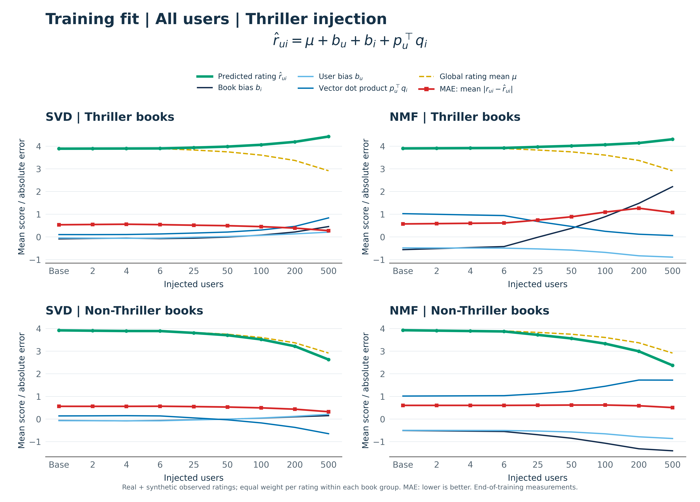
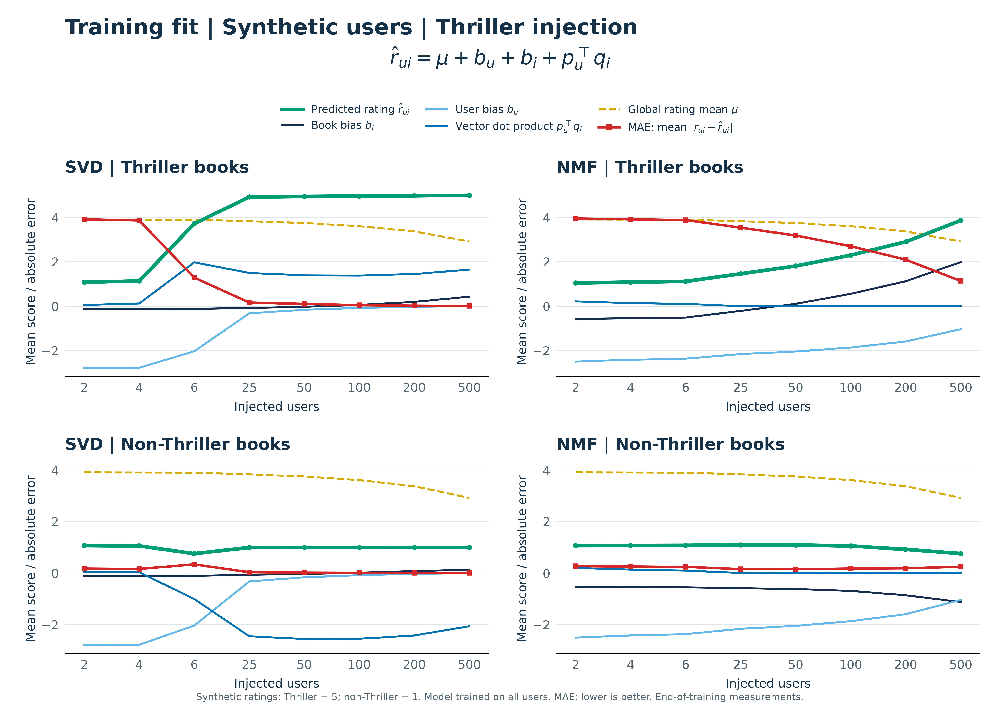
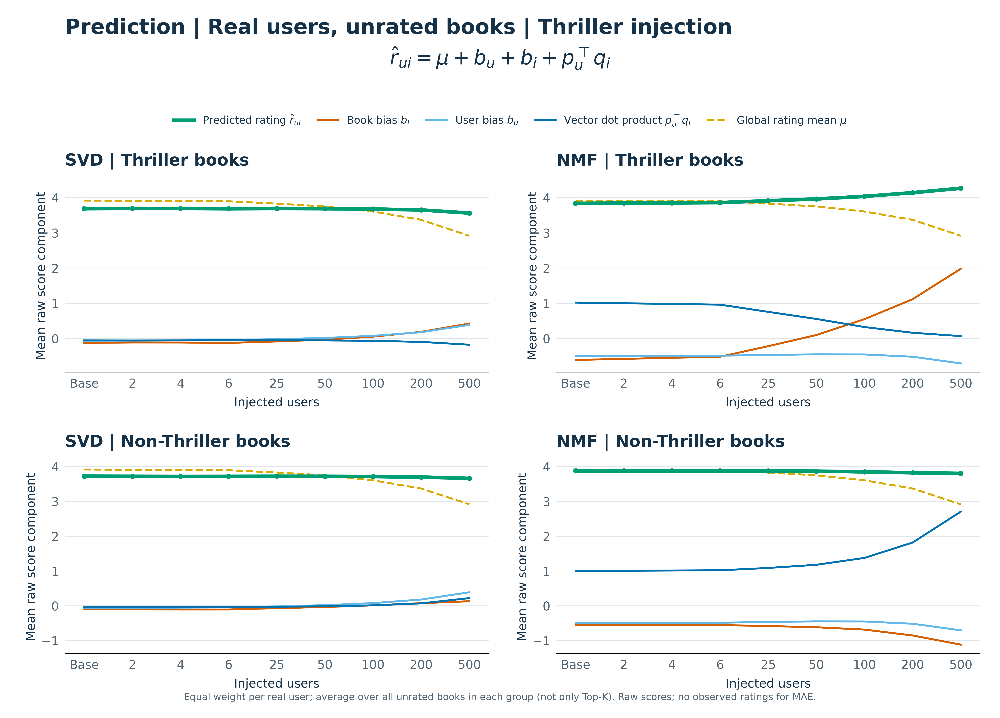

# Spoken guide: training, fake users, and prediction

Simple spoken English. Read the paragraphs aloud; use the equations as prompts when someone asks which part of the model you mean.

## 1. First figure — training ratings from all users

“First, let’s look at the overall picture. This figure includes the training ratings from both real and fake users. The top row shows Thriller books. The bottom row shows non-Thriller books. SVD is on the left, and NMF is on the right.

The horizontal axis shows how many fake users we added. It does not show training time. Each point comes from a model after training has finished.

Let’s start with the formula. The green predicted rating is the sum of four parts.”

$$
\underbrace{\hat r_{ui}}_{\text{green: predicted rating}}
=
\underbrace{\mu}_{\text{yellow: global mean}}
+
\underbrace{b_u}_{\text{light blue: user bias}}
+
\underbrace{b_i}_{\text{orange: book bias}}
+
\underbrace{p_u^\top q_i}_{\text{blue: dot product}}.
$$

“Here, u means the user, and i means the book. A bias is a learned number that adjusts a score. The vectors are learned lists of numbers. We multiply their matching numbers and add the results to get the dot product.

The yellow global mean is the same in SVD and NMF because both models use the same ratings. It stays fixed during each training run. But it changes between injection conditions. Here it falls from about 3.92 to 2.92, because the added profiles contain many ratings of one.”

**Point to:**

$$
\mu_n=
\frac{\sum_{(u,i,r)\in R_0}r+n(5N_T+N_O)}
{|R_0|+n(N_T+N_O)}.
$$

Here, n is the fake-user count, R₀ is the original set of ratings, N_T is the number of Thriller books, and N_O is the number of non-Thriller books. Each fake user rates the full catalog. The mean falls here because the fake profiles’ average rating is lower than the original average.

“Now, let’s look at SVD. Its average Thriller prediction rises from 3.89 to 4.42. Book bias, user bias, and the dot product all increase. Together, their increases are larger than the fall in the global mean.”

**Point to the change in the same score formula:**

$$
\Delta\overline{\hat r}
=\Delta\mu+\Delta\overline{b_u}
+\Delta\overline{b_i}+\Delta\overline{p_u^\top q_i}.
$$

A bar means an average over the selected rating pairs. Delta means the value after injection minus the baseline value. The rating mixture changes between these conditions.

“For SVD’s non-Thriller books, the prediction falls from 3.92 to 2.63. The global mean falls, and the dot product becomes negative. These decreases are larger than the increases in the two biases.

Now, look at NMF. Its Thriller prediction rises from 3.90 to 4.31. The orange book-bias line rises strongly, while the blue dot-product line falls close to zero. The book-bias increase is larger than the decreases in the other three parts.”

**Point to NMF Thriller:**

$$
\overline{b_i}: -0.56\rightarrow2.22,
\qquad
\overline{p_u^\top q_i}:1.03\rightarrow0.06.
$$

“For NMF’s non-Thriller books, book bias becomes more negative. The dot product increases, but it does not fully balance the decreases in the other parts. The final prediction falls from 3.93 to 2.37.”

**Point to NMF non-Thriller:**

$$
\overline{b_i}:-0.51\rightarrow-1.40,
\qquad
\overline{p_u^\top q_i}:1.02\rightarrow1.72.
$$

“The red line is MAE. We compare each predicted rating with its recorded rating, take the distance without its sign, and average these distances. Lower means a closer fit to the training ratings.”

$$
\mathrm{MAE}
=\frac{1}{|R_g^{(n)}|}
\sum_{(u,i,r_{ui})\in R_g^{(n)}}|r_{ui}-\hat r_{ui}|.
$$

R_g⁽ⁿ⁾ means the recorded training ratings in the plotted book group at injection count n. It includes real and fake ratings in this figure.

“As we can see, SVD has lower training MAE for both book groups at the injection levels shown. At 500 fake users, Thriller MAE is about 0.28 for SVD and 1.08 for NMF. Non-Thriller MAE is about 0.32 for SVD and 0.51 for NMF.

These are averages over ratings, not equal averages over users. As we add fake users, their ratings take a larger share of the average. Lower training error does not automatically mean better recommendations for unread books.”

## 2. Second figure — training ratings from fake users only

“Now, to understand these patterns better, let’s move to the second figure. We use the same trained models, but this time we measure only the fake users’ ratings.

The fake users give every Thriller book five and every non-Thriller book one. So, we know exactly which ratings the models are trying to predict.”

$$
r_{ui}=
\begin{cases}
5,&i\text{ is Thriller},\\
1,&i\text{ is non-Thriller}.
\end{cases}
$$

“As we can see, SVD gets much closer to five for Thriller books. With 500 fake users, its average prediction is almost five, and its MAE is about 0.012. NMF predicts about 3.86, with an MAE of 1.14.

Look at the blue lines in SVD. For Thriller books, the dot product is positive and raises the score. For non-Thriller books, it is negative and lowers the score.”

**At 500 fake users, point to the four terms:**

$$
\text{SVD, Thriller:}\quad
\underbrace{2.9179}_{\mu}
+\underbrace{0.0040}_{b_u}
+\underbrace{0.4291}_{b_i}
+\underbrace{1.6484}_{p_u^\top q_i}
\approx5.00.
$$

$$
\text{SVD, non-Thriller:}\quad
\underbrace{2.9179}_{\mu}
+\underbrace{0.0040}_{b_u}
+\underbrace{0.1332}_{b_i}
+\underbrace{(-2.0605)}_{p_u^\top q_i}
\approx0.9947.
$$

“In NMF, the dot products become almost zero in both groups. Most of the final score comes from the global mean, user bias, and book bias.”

$$
\text{NMF, Thriller:}\quad
\underbrace{2.9179}_{\mu}
+\underbrace{(-1.0391)}_{b_u}
+\underbrace{1.9856}_{b_i}
+\underbrace{0.000002}_{p_u^\top q_i}
\approx3.8645.
$$

$$
\text{NMF, non-Thriller:}\quad
\underbrace{2.9179}_{\mu}
+\underbrace{(-1.0391)}_{b_u}
+\underbrace{(-1.1205)}_{b_i}
+\underbrace{0.000075}_{p_u^\top q_i}
\approx0.7584.
$$

These examples use rounded averages, so small rounding differences are expected.

“The fake-user bias is the same across the two book groups within each model. The same fake users rate every book. Each user has one b_u, so this number cannot make Thriller higher than non-Thriller for that same person.

For the non-Thriller ratings of one, SVD predicts about 0.995 with MAE 0.006. NMF predicts about 0.76 with MAE 0.24.

So, the models fit the injected ratings in different ways. But these are not models trained only on fake users. Both were trained on the full real-plus-fake dataset. We only changed which ratings we measured.”

## 3. Third figure — prediction for real users’ unrated books

“Now, let’s move to the third figure. Until now, we looked at ratings already in the training data. Here, we look at books that real users have not rated.

Training has finished. We keep the learned values. For each real user, we remove books they have already rated. Then we use the same formula to score the remaining books. We do not update the model at this stage.”

$$
\hat r_{ui}=\mu+b_u+b_i+p_u^\top q_i,
\qquad i\text{ is a book user }u\text{ has not rated}.
$$

“For the figure, we first average over each user’s unrated Thriller books, and then across real users. We do the same for non-Thriller books. So, every real user has equal weight. These are all unrated candidate books, not just the Top-15.

There is no red MAE line here. We do not have a recorded rating for these user–book pairs to compare with the prediction.”

**The averaging step is:**

$$
\overline{\hat r}_g^{(n)}
=\frac{1}{|U_0|}\sum_{u\in U_0}
\frac{1}{|A_g(u)|}\sum_{i\in A_g(u)}\hat r_{ui}^{(n)}.
$$

U₀ means the real users. A_g(u) means the unrated books in group g for user u. All users in this calculation have eligible books in both groups.

“Look at NMF. Its mean Thriller prediction rises from 3.84 to 4.27. The mean non-Thriller prediction changes from 3.88 to 3.81. At baseline, Thriller is slightly below non-Thriller. With 500 fake users, it is about 0.46 above non-Thriller.”

$$
\text{NMF mean-score gap:}\quad
3.8385-3.8804\approx-0.04
\quad\longrightarrow\quad
4.2674-3.8065\approx+0.46.
$$

“The orange Thriller book bias rises strongly, from about minus 0.61 to plus 1.98. Its blue dot product falls from about 1.02 to 0.07. The book-bias increase is larger than the decreases in the other parts.

For non-Thriller books, the blue dot product rises from about 1.01 to 2.71. It balances much of the decrease in the global mean and biases, so the green line changes only a little.

In SVD, the mean Thriller score falls from 3.69 to 3.56. The mean non-Thriller score falls from 3.73 to 3.66. These averages describe all candidate books. They do not directly tell us which books enter the top of each user’s list.

To decide which book comes first for the same user, we compare their scores. The global mean and user bias cancel. The difference comes from book bias and the dot products.”

$$
\underbrace{\hat r_{ui}-\hat r_{uj}}_{\text{score difference}}
=
\underbrace{b_i-b_j}_{\text{book-bias difference}}
+
\underbrace{p_u^\top(q_i-q_j)}_{\text{dot-product difference}},
$$

where i is one candidate Thriller book and j is one candidate non-Thriller book.

“Finally, how do we show that more Thriller books are recommended? We rank each real user’s unrated books by score. We select the Top-15, Top-25, or Top-35. Then we count Thriller books in each list and average across users.”

$$
C_T^{(n)}@K
=\frac{1}{|U_0|}\sum_{u\in U_0}
\sum_{i\in L_K^{(n)}(u)}\mathbf 1\{i\text{ is Thriller}\}.
$$

L_K⁽ⁿ⁾(u) is user u’s K recommended books. The indicator is one for Thriller and zero otherwise.

“For NMF, the Top-15 mean rises from about 1.74 at six fake users to 2.38 at 25, 3.73 at 50, 7.02 at 100, 10.42 at 200, and 10.84 at 500. Top-25 and Top-35 also increase across these tested levels.

So, the recommendation counts directly show the increase. The prediction figure helps explain the score pattern behind it. We describe an increasing response over the tested range from six to 500. We do not claim that every extra fake user must always increase the count. For example, there is a small Top-15 decrease between two and four fake users. SVD also does not show the same continued rise at larger injection counts.”

## 4. Now, what did we think before, what did the reviewer suggest, and what have we found?

“Now, after looking at all three figures, what did we think before, what did the reviewer suggest, and what have we found?

Our earlier explanation was about the final score. We said that NMF cannot have a negative dot product, so it would produce larger scores.”

**The valid property, but not a complete score comparison, is:**

$$
p_u\geq0,\ q_i\geq0
\quad\Rightarrow\quad p_u^\top q_i\geq0.
$$

“We also used a simple example about vector size. We assumed one factor needed a range of ten units: minus five to plus five in SVD, but zero to ten in NMF. We connected the larger squared values in that example to the penalty on vector size. But the equal ten-unit range was our assumption. It was not a measured result or a requirement of the algorithms.”

**The part we were discussing was the vector penalty:**

$$
\lambda_p\|p_u\|_2^2+\lambda_q\|q_i\|_2^2,
\qquad \|p_u\|_2^2=\sum_f p_{uf}^2.
$$

“The reviewer said that non-negative values do not automatically mean larger vectors or larger final predictions. Biases can change too.

The reviewer suggested a different explanation. SVD can use a negative dot product to lower a score. NMF cannot use that route. They suggested this could put more pressure on book bias.”

**A teaching example — not an experimental measurement:**

$$
\text{SVD:}\quad
\underbrace{3}_{\mu+b_u+b_i}
+\underbrace{(-2)}_{p_u^\top q_i}=1,
\qquad
\text{NMF:}\quad
\underbrace{1}_{\mu+b_u+b_i}
+\underbrace{0}_{p_u^\top q_i}=1.
$$

“Both can reach the same final score, but with different parts. So, our old statement and the reviewer’s idea were not the same.

What have we shown now? For the fake users’ non-Thriller ratings, SVD uses negative dot products. In NMF, these dot products move close to zero. The global mean and biases supply nearly all of the remaining score. That supports part of the reviewer’s idea, but it does not show that all correction goes into book bias.

Now, why does NMF recommend more Thriller books to real users? For the same real user, the global mean and user bias cannot change the order of candidate books. Book bias and the dot-product differences determine that order.”

**Return to the ranking formula:**

$$
\hat r_{ui}-\hat r_{uj}
=(b_i-b_j)+p_u^\top(q_i-q_j).
$$

“Our separate candidate-score and component-replacement analyses show a stronger Thriller book-bias advantage in NMF. The vector changes work against part of that advantage. However, in the examined conditions, the positive recommendation contribution from book bias is larger.

By component replacement, I mean that we calculated rankings using old book biases with new vectors, and new book biases with old vectors. This lets us measure how these fitted components contribute to the recommendation change. It is not a new training experiment.”

**For these ranking comparisons, the relevant score is:**

$$
s_{ui}=b_i+p_u^\top q_i.
$$

“The recommendation counts then confirm that NMF gives more Thriller books across the tested levels from six to 500 fake users.

So, our updated explanation is clear: in these experiments, NMF learns a larger Thriller book-bias advantage. The vectors partly balance it, but the positive bias contribution is larger in our recommendation analysis.

Our hypothesis is that the non-negative constraint and NMF’s training update method help create this pattern. The measurements support this explanation, but we have not separated the individual effect of each factor.

We no longer say, ‘NMF is non-negative, so its scores must be higher.’ We now say, ‘The measured balance between book biases and vectors helps explain why NMF recommends more Thriller books in these experiments.’”
